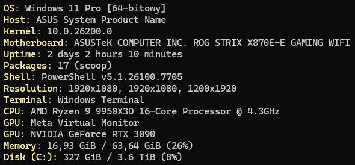
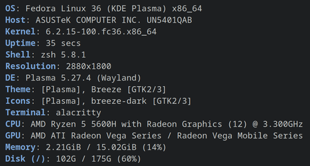
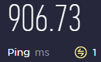

# Hi, I'm Eryk! 👋🏼

I'm a **computer polyglot** 👨🏼‍💻 from Łódź 🇵🇱🇪🇺, currently in my third year of Computer Science at [ANSB](https://www.ansb.pl/).\
I tinker with everything under the tech umbrella: **game dev, VR, 3D modeling & printing, electronics, networking, hacking**, and plenty of software.

## 🛠 Working on

- 🥽 A **DIY low-cost VR finger tracking** solution (my final University project)
- 🎮 Post-launch work on **[Demersus][demersus]**
- ✍️ My [tech blog](https://www.erykdarnowski.pl/), plus [devlogs](https://www.erykdarnowski.pl/series/demersus-devlogs/)
- 📹 An upcoming [engineering YouTube channel](https://www.erykdarnowski.pl/sm?yt)

## 🏆 Highlights

  

- 🎮 **[Demersus][demersus]**: a first-person atmospheric walking sim about alcohol addiction, made by two people (me and [Jakub](https://jakubklimczak.pl/))
  - 🥇 **Best Game Audio** at **ZTGK 2026**, plus a nomination for **SGF 2026** (Student Games Festival)
  - 📈 Self-published and free on [Steam][demersus] / [itch.io][itch]: **8k+ library adds, 93% positive reviews, 150k impressions**
- 🖨️ **[MakerWorld](https://www.erykdarnowski.pl/sm?mw)** 3D models with **3.1M+ impressions, 100k views, 1.7k prints**
- 🧩 Contributor to **[Return YouTube Dislike](https://github.com/Anarios/return-youtube-dislike)**, which has 5M+ users
- 🎓 Academic scholarships throughout Technical School and University
- 🚁 EU-certified drone pilot (A1 / A3)

*Stats as of 30/10/2026*

## 💻 How I work

  
   
  /
   
  
   
  +
   
  
   
  +
   
  <!-- Systems & tools -->
  
  
  
  
  
  
  
  
  
  
  
  
   
  <!-- Languages -->
  
  
  
  
  
  
  
  
  
  
  
  
   
  <!-- Web, data, game dev & design -->
  
  
  
  
  
  
  
  
  
  
  

## 🌐 Find me

  
  
  
  
  

## ⚡ Fun facts

- I use Neovim 😱
- I'm into VR: a SteamVR full-body tracking setup, plus a Quest 3 I've modded with DIY face tracking 🥽
- I collect retro video game controllers / hardware 🎮
- [My speed typing personal best is ~`193`WPM / ~`965`CPM ⌨️](https://typingstats.com/profile/294040439810560000)
- I can solve a few Rubik's cubes (2x2, 3x3, 4x4 and 5x5) 🧊
- My take on Andrew Price's Blender donut is [part of the *17,731 First Steps* collection](https://andrewprice.art/17731-first-steps/donut/6087) 🍩

## 📈 Stats

  
   
   
  

[demersus]: https://store.steampowered.com/app/5224380/Demersus/
[itch]: https://darklim-studios.itch.io/demersus
